

  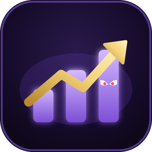

<h1 align="center">Idle Manager</h1>

  <b>Painel e bot para o <a href="https://pokeidle.io">pokeidle.io</a>: suas contas caçando sozinhas, dia e noite.</b> 
  Até 4 contas numa tela só, captura, poções e compras automáticas, mercado com preço justo, Top Catch, PvP e avisos no Discord.

  
  
  
  

  <b>Grátis no Windows com 2 contas, sem anúncios.</b> Site: <a href="https://idlemanager.com">idlemanager.com</a>

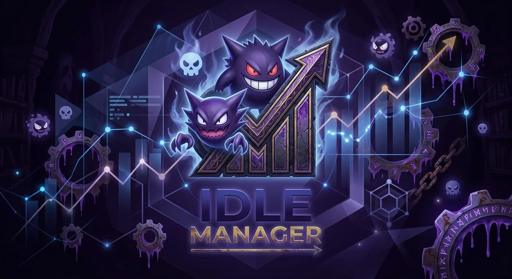

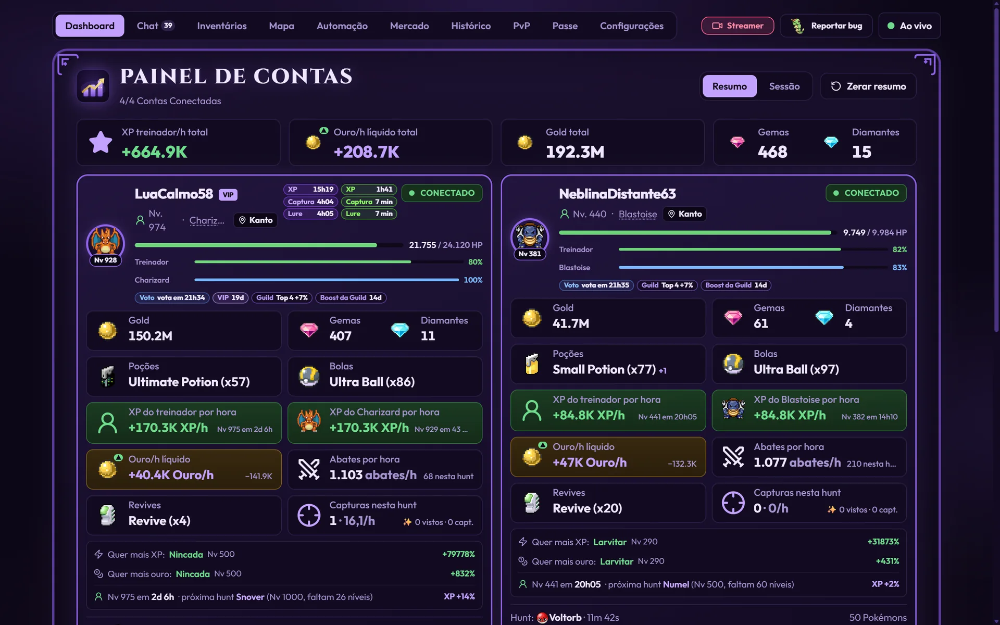

---

## Por que usar

- **Todas as contas numa tela só.** XP do treinador e do Pokémon por hora, ouro por hora já descontando o que a conta gasta, HP, poções, bolas, revives, Gemas, Diamantes e o tempo para o próximo nível.
- **O trabalho repetitivo fica com o bot.** Captura com a sua ordem de bolas, poção e reviver na hora certa, compra na loja quando o estoque acaba, volta para a hunt depois do Centro Pokémon, resgata o passe diário.
- **Caça inteligente.** Escolhe a melhor hunt (e o melhor Pokémon do time) para XP, ouro, Bestiário ou Top Catch, e troca sozinha quando vale a pena.
- **Mercado sem achismo.** Preço justo de cada anúncio pelas vendas reais, oportunidades de revenda com lucro, sniper e alertas com foto.
- **Funciona no celular.** O painel inteiro, com barra de abas embaixo.
- **Seus dados ficam com você.** Na versão para Windows, a sessão das contas nunca sai do seu computador.

## Funções

### Caça e automação
- Captura automática na ordem de bolas que você escolher, com poção, revive e limite de HP calculado para a poção curar inteira.
- **Caça inteligente** com metas de XP, ouro, Bestiário e **Top Catch** (espécies novas da semana).
- **Melhor Pokémon** para cada área e no Prey (toque num dos 9 e veja quem rende mais).
- Prey automático com escolha de regiões e roleta do bônus fraco.
- Raids, bosses, oferenda e sacrifício automáticos, sem tocar no que você protegeu.
- Venda e anúncio automático de repetidos, Auto Venda do Depot.

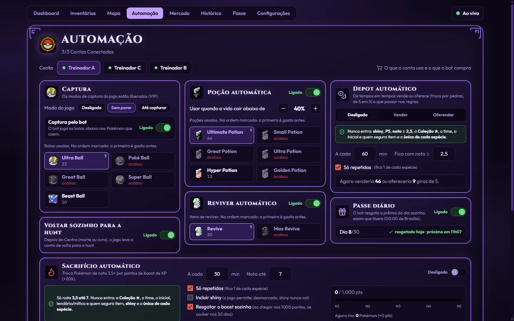

### Mapa
- Mande qualquer conta caçar em qualquer área, sem abrir o jogo.
- As melhores hunts para o seu Pokémon, com XP por hora estimado e risco.
- **Top Catch da semana:** posição no ranking, próximo marco e as hunts com mais espécies que faltam.
- Análise da área (fraquezas, resistências, drops), que no celular vira uma janela flutuante.

  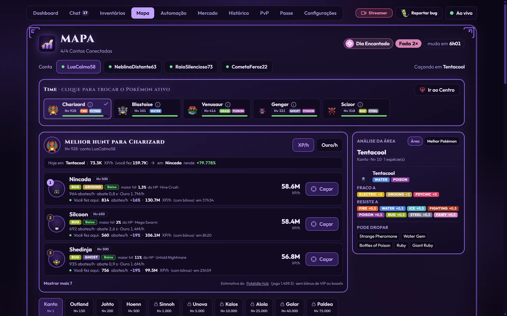
  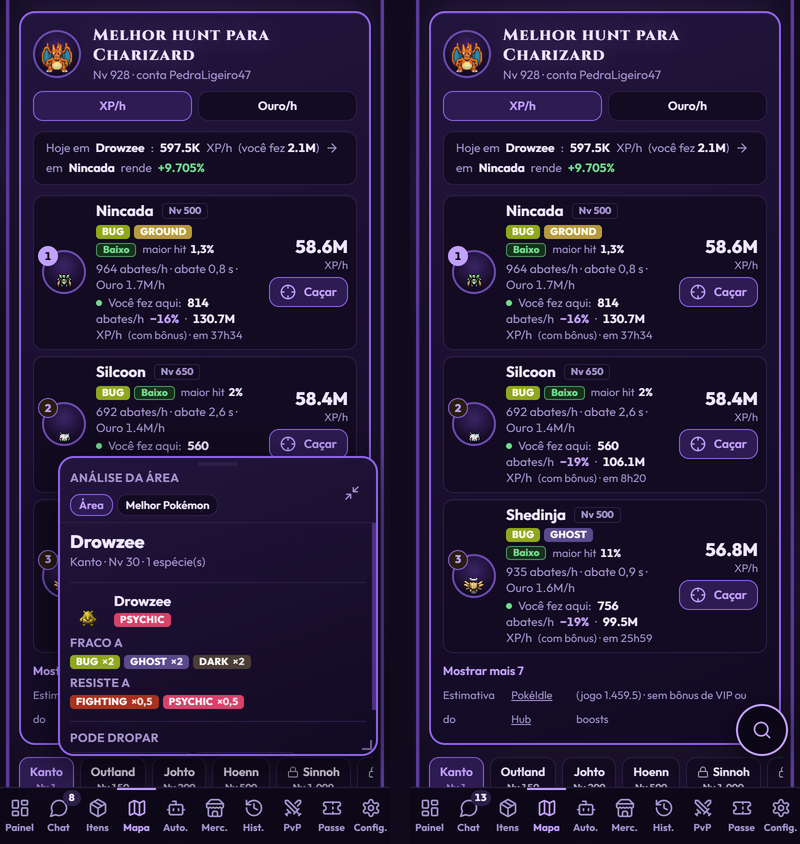

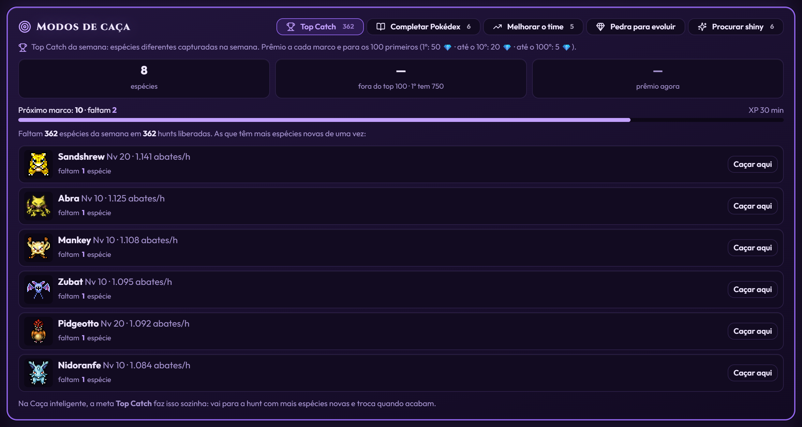

### Mercado
- Preço justo pelas vendas reais: vender rápido, no preço ou esperando.
- **Para revender:** anúncios com desconto que dá para comprar e anunciar de novo com lucro, já sem as taxas.
- **Para farmar:** o Pokémon que mais rende XP, ouro ou abates dentro do seu orçamento.
- Sniper por regra (vem desligado) e alertas com foto e link direto.
- **Análise do mercado** do servidor inteiro: o que subiu, o que caiu e o preço diário.

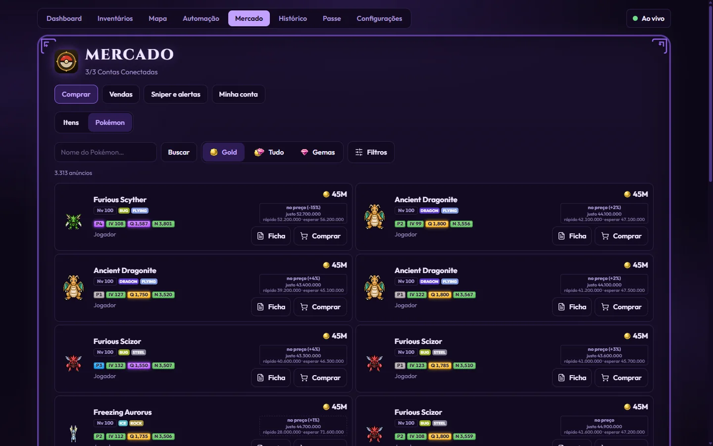

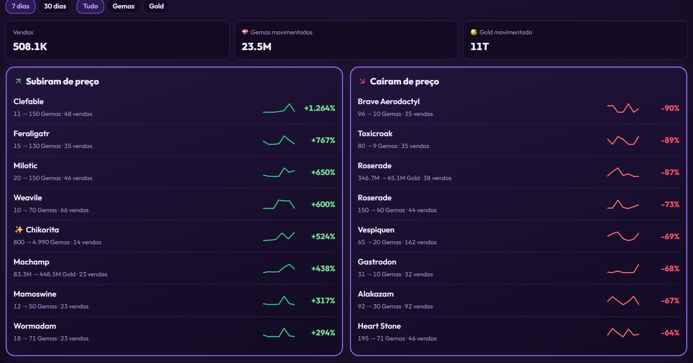

### PvP
- Fila automática, equipe sugerida, **Contra o meta** (monta a equipe que resiste ao que os adversários mais usam) e equipe para o Torneio da Comunidade.
- Vitórias, derrotas e partidas da semana, com aviso de subida e queda de divisão.

### Avisos
- No painel e no Discord: shiny visto ou capturado, captura rara com a nota da ficha, drop raro, conta que caiu, marco do Top Catch, divisão do PvP, voto liberado e mais. Cada um pode ser ligado ou desligado.

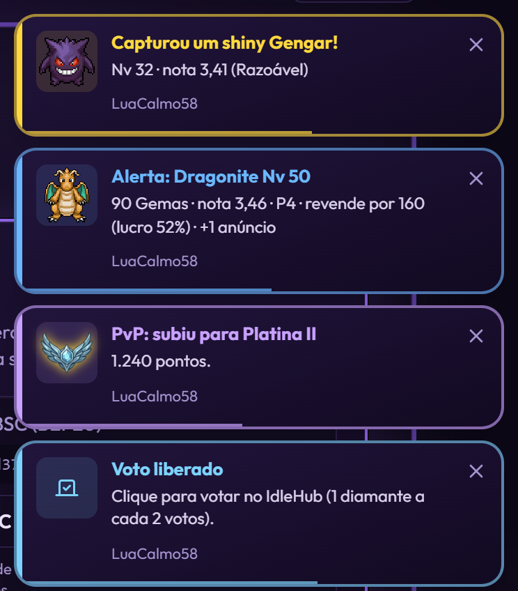

### Histórico e celular
- Histórico de 7, 30 e 90 dias: XP, ouro, capturas, sessões e o desempenho de cada hunt.
- Painel inteiro no celular.

  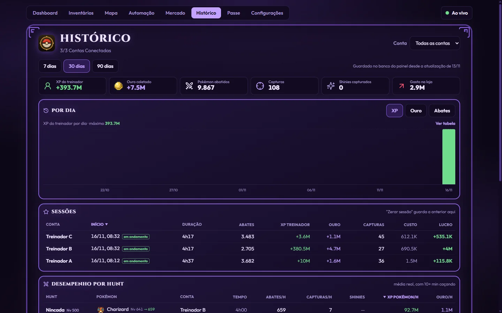
  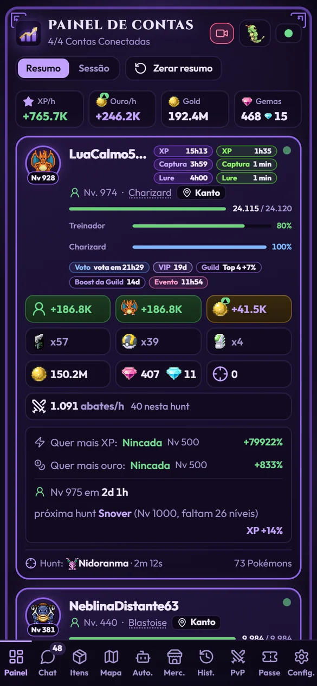

## Como instalar (Windows 10 e 11)

1. Baixe o `IdleManager-Setup-x.y.z.exe` em **[Releases](https://github.com/prado1506/pokeidle-idle-manager/releases/latest)** (ou pela [Microsoft Store](https://apps.microsoft.com/detail/9MSQ0ZN24P58)).
2. Abra o instalador. Na primeira vez o Windows pode mostrar o aviso do SmartScreen ("Mais informações" › "Executar assim mesmo"); pela Microsoft Store não aparece aviso.
3. Crie sua conta no app e conecte a conta do jogo entrando pelo próprio painel, sem copiar código nenhum.
4. O app se atualiza sozinho quando sai versão nova.

Prefere não instalar nada? Use o **[painel online](https://painel.idlemanager.com/#cadastro)**: as contas rodam no servidor 24 horas, com o PC desligado.

## Quanto custa

| | Windows | Painel online |
|---|---|---|
| Contas de graça | **2** | só para doadores |
| Contas para quem doa | 4 | 4 |
| PC ligado | precisa | não precisa (roda 24 h no servidor) |
| Dados das contas | só no seu computador | no servidor do Idle Manager |

Doação: R$ 5 por conta a cada 30 dias (até 4 contas: R$ 20). Detalhes no [site](https://idlemanager.com) e no [Discord](https://discord.gg/JdcySEJSzC).

## Perguntas

**O jogo permite usar isso?** Os [termos do pokeidle.io](https://pokeidle.io/terms#conduta) permitem automação que siga as mesmas regras de quem joga na mão: sem explorar falhas, sem burlar limites (como o de 4 contas por pessoa) e sem sobrecarregar o servidor. O Idle Manager respeita essas regras, mas a responsabilidade pelo uso é de cada jogador.

**Preciso deixar o jogo aberto?** Não. Abrir a mesma conta no navegador derruba a conexão do bot; ele espera alguns minutos e volta sozinho.

**Cadê o código-fonte?** O Idle Manager não é código aberto. Este repositório tem só as versões compiladas (Releases) e as novidades de cada uma.

**Achei um problema / tenho uma ideia.** Abra uma [issue](https://github.com/prado1506/pokeidle-idle-manager/issues) ou fale no [Discord](https://discord.gg/JdcySEJSzC).

---

Idle Manager é um projeto de fã, não oficial, sem relação com o pokeidle.io ou seus desenvolvedores. Pokémon e os nomes dos personagens são marcas da Nintendo, Creatures e Game Freak.

**English:** Idle Manager is a dashboard and bot for the browser game pokeidle.io: up to 4 accounts on one screen, auto-catch, potions and shop restock, smart hunting, fair market prices, PvP helper and Discord alerts. Free on Windows with 2 accounts. The interface is in Portuguese. Download from [Releases](https://github.com/prado1506/pokeidle-idle-manager/releases/latest).
